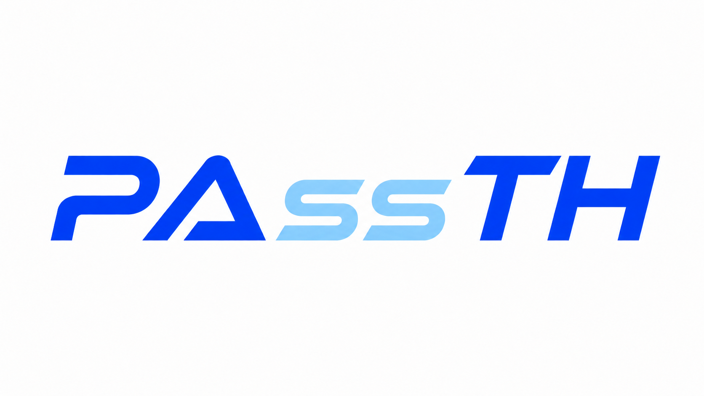
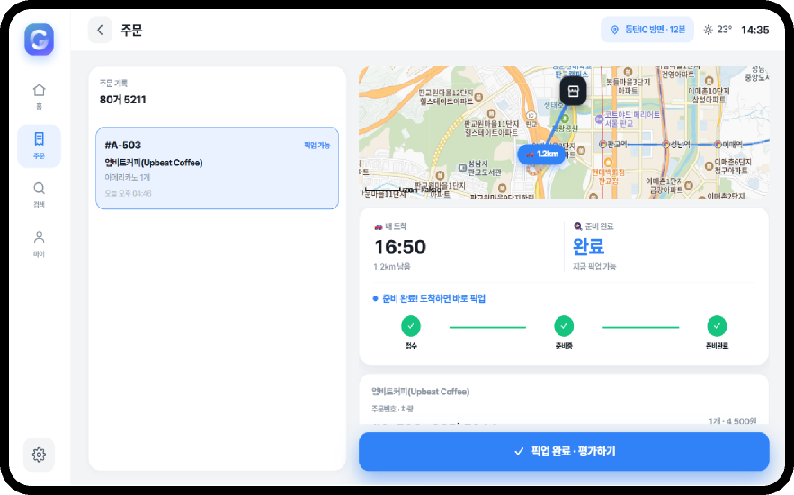
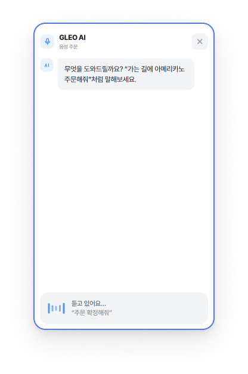
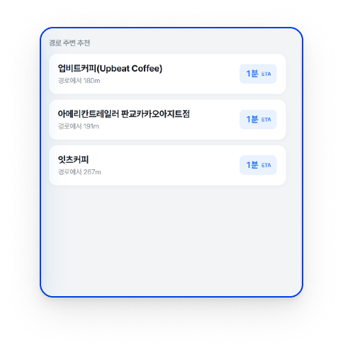
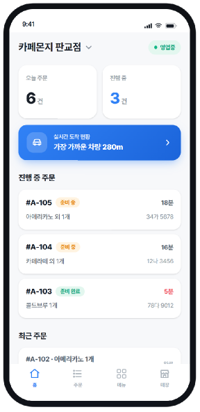
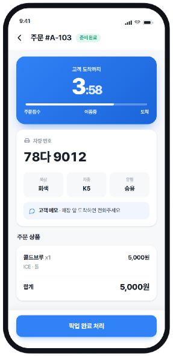
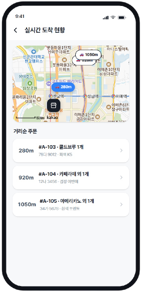
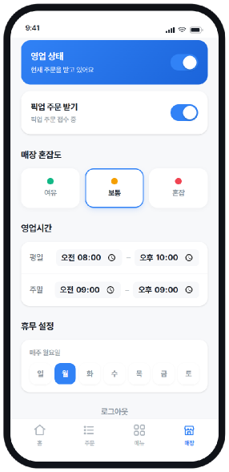
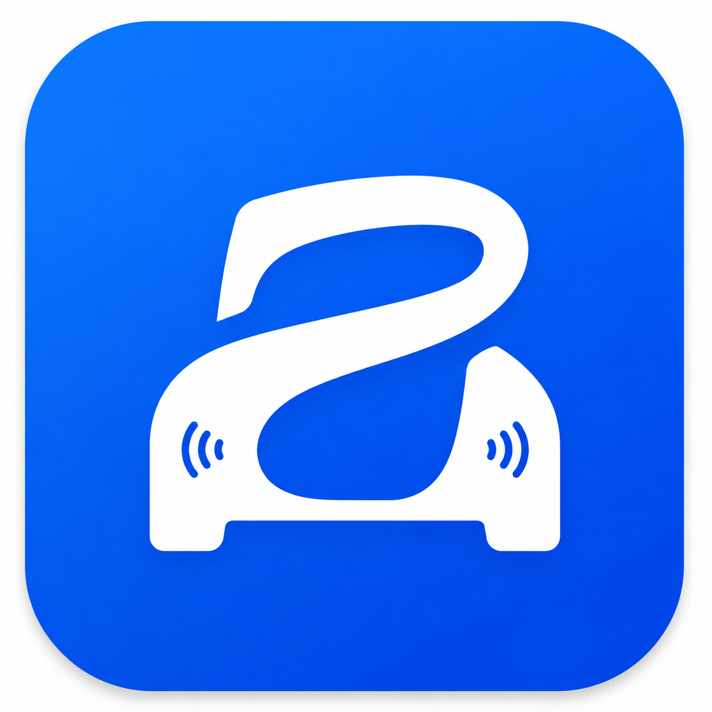

<p align="center">
  
</p>

<h3 align="center">가는 길에, 미리 주문하세요</h3>

<p align="center">
  플레오스(Pleos) 인포테인먼트에 AI 에이전트를 결합한<br/>
  <b>차량 인카페이먼트 기반 사전주문·픽업 플랫폼</b>
</p>

<p align="center">
  
  
  
  
  
  
</p>

---

## 한눈에 보기

**PAssTH(패스스루)** = **Pass** + **Path**. 운전 중에 **차량 화면에서 음성으로** 경로 위 매장에
주문하고, 결제는 차량 인카페이먼트로 끝내고, **도착 시간에 맞춰 준비된 음식을 바로 받아 가는**
서비스입니다. 매장 사장님은 전용 앱에서 주문과 **고객 차량의 실시간 도착 ETA**를 보면서
타이밍에 맞춰 조리합니다.

| | |
| --- | --- |
| **출품** | 현대자동차그룹 차량용 앱 개발 공모전 (1차 제출) |
| **운전자 앱** | Pleos 인포테인먼트(1280×720)용. 음성·터치로 주문하고 픽업 |
| **가맹점 앱** | 모바일. 실시간 주문 수신, 고객 도착 ETA, 메뉴·매장 관리 |
| **AI** | GLEO AI 음성 에이전트. 대화로 매장 추천부터 주문 확정까지 |
| **연결** | 하나의 백엔드·DB. 운전자 주문이 **새로고침 없이** 사장님 화면에 바로 표시 |

---

## 왜 PAssTH인가

### 시장: 이제 인카페이먼트를 볼 때
- 현대자동차는 **플레오스 커넥트**를 중심으로 SDV 전환을 진행하고 있고, **2030년까지 약 2천만 대**에
  탑재할 계획입니다. (연합뉴스, 2026)
- 인카페이먼트 시장은 **2025년 59억 달러에서 2034년 246.5억 달러**로 커질 것으로 전망됩니다.
  (The Insight Partners, 2026)

### 문제: 차 안에서 주문하는 게 아직 불편하다

| 이해관계자 | Pain Point |
| --- | --- |
| **운전자** | 운전 중에 휴대폰을 꺼내 검색하고 결제해야 함. 매장까지 걸리는 시간과 조리 시간을 직접 계산해야 함 |
| **개인 카페·음식점** | 배달앱의 높은 수수료(포장 6.8%), 경기 침체, 차량 고객을 받을 채널이 없음 |
| **프랜차이즈** | 브랜드 인지도는 있지만 차량 채널이라는 접점 자체가 없음 |
| **플레오스(카페이)** | 식음료(F&B) 가맹점이 비어 있어 인카페이먼트 활성화가 어려움 |

기존 서비스는 **스마트폰 앱 주문**이라 운전 중에 쓰기 어렵거나, **인카페이먼트는 되지만 편의점·주유소
위주**였습니다. 인카페이먼트와 AI 에이전트를 결합한 픽업 플랫폼은 아직 없었습니다.

### 해결: 인카페이먼트 + AI 에이전트

| | 기존 | PAssTH |
| --- | --- | --- |
| 주문 | 폰 꺼내서 앱 조작 | **GLEO AI 음성 주문** (핸즈프리) |
| 매장 선택 | 직접 검색 | **경로·ETA 기반 AI 매장 추천** |
| 타이밍 | "언제 주문해야 안 기다리지?" | **도착 ETA vs 조리 완료 시각** 자동 비교 |
| 결제 | 카드 꺼내서 결제 | **차량 등록 결제수단(카페이)** 으로 자동 결제 |
| 픽업 (매장) | 주문자 찾아 헤맴 | **차량번호·색상·차종 + 도착 카운트다운** 으로 정확히 전달 |
| 매장 노출 | 배달앱·SNS 의존 | **경로 주변 운전자에게 자동 추천**되는 새 매출 채널 |

---

## 화면

### 운전자: Pleos 인포테인먼트

<p align="center">
  
</p>
<p align="center"><sub>픽업 진행 화면: 지도 위 매장까지의 경로, <b>내 도착 시각</b>과 <b>준비 완료 상태</b>를 나란히 보여 줍니다</sub></p>

<p align="center">
  
  &nbsp;&nbsp;
  
</p>
<p align="center"><sub>왼쪽: GLEO AI 음성 주문 패널 · 오른쪽: 경로 주변 매장 추천 (ETA 순)</sub></p>

### 가맹점(사장님) 앱

<p align="center">
  
  
  
  
</p>
<p align="center"><sub>홈(진행 중 주문·가장 가까운 차량) · 주문 상세(도착 카운트다운·차량 정보) · 실시간 도착 지도 · 매장 관리(영업·혼잡도·영업시간)</sub></p>

---

## 핵심 기능

### 운전자 (in-car)
- **GLEO AI 음성 주문**: "카페 있어?", "아메리카노", "잇츠커피 가 줘"처럼 말하면 대화로 매장 선택부터
  주문 확정까지 진행합니다. 화면의 빠른 응답 버튼(응 / 다른 매장 / 결제)으로도 답할 수 있습니다.
- **경로·ETA 기반 매장 추천**: Kakao 길찾기로 계산한 실제 **도착 ETA와 거리** 순으로 정렬하고, 스폰서 매장도 함께 노출합니다.
- **리스트 / 지도 전환**: Kakao 지도 위 매장 핀을 탭하면 매장 정보 카드가 열립니다.
- **"가는 길에" 픽업 타임라인**: *내 도착 예정 시각*과 *조리 완료 예정 시각*을 비교해
  "도착에 딱 맞춰 준비돼요 / N분 대기"를 판정합니다.
- 메뉴·옵션 선택 → 결제 → **실시간 픽업 진행**(접수 → 준비중 → 준비완료) → 별점·후기 → 기록에서 재주문

### 가맹점 (merchant)
- **실시간 주문 수신**: 터치·음성·외부 주문이 새로고침 없이 바로 뜨고, 도착 알림 오버레이가 표시됩니다.
- **ETA 기반 주문 현황**: 고객 도착까지 카운트다운, 차량번호·색상·차종, 고객 메모
- **실시간 도착 지도**: 주문한 차량들의 위치와 거리를 Kakao 지도에서 거리순으로 확인
- 주문 상태 진행(수락·조리시간 조절·완료), **메뉴 관리**(사진 업로드·품절 토글·CRUD)
- **매장 관리**: 영업/픽업 on·off, **혼잡도 설정(AI 추천에 반영)**, 영업시간·휴무일

---

## 데모 시나리오

```
운전자: (마이크) "스타벅스 가고 싶어"
 GLEO : "스타벅스 판교점이 3분으로 가장 빨라요. 이 매장으로 주문할까요?"   [응 / 다른 매장]
운전자: "응"
 GLEO : "어떤 메뉴로 드릴까요?"                                          [아이스 아메리카노 / …]
운전자: "아이스 아메리카노"
 GLEO : "담았어요. 결제할까요?"                                          [결제 / 메뉴 더]
운전자: "결제"
 GLEO : "주문이 매장에 전달됐어요. 도착 시간에 맞춰 준비할게요."
   ↓  (같은 순간)
사장님 /orders : 신규 주문 #A-### 아이스 아메리카노 · 12가 3456   ← 새로고침 없이 등장
사장님        : 수락 → 준비중 → 준비완료
   ↓
운전자 픽업 화면 : 접수 → 준비중 → 준비완료  "도착하면 바로 픽업"
```

---

## AI 음성 주문 구조

```
 발화 입력 ──▶ 의도 이해 ──▶ 매장 검색 ──▶ 스코어링 ──▶ 주문 확정
 (음성 / 텍스트 / 버튼    카테고리형 "카페 있어?"   Kakao API로       허용오차 필터          결제(데모: mock)
  모두 같은 처리 경로)     메뉴형   "아메리카노"     매장 검색 +       (최단 ETA + N분)      주문번호 발급
                          브랜드형 "잇츠커피 가 줘"  이동 ETA 계산     DB 파트너 매칭         거절 시 다음 순위
                                                                    이름 우선순위 가중     재추천
                 └──────────── 세션 상태 관리 (STATE_* 전이, session_id) ────────────┘
```

| 단계 | 위치 | 구현 |
| --- | --- | --- |
| STT (음성 → 텍스트) | 브라우저 | Web Speech API (`WebSpeechStt`) |
| **대화·의도 이해·추천** | AI 서버 (Python) | FastAPI `POST /order/turn` + OpenAI. 매장 검색·메뉴·주문을 담당 |
| 프록시 · 주문 브리지 | Next 서버 | `/api/voice/turn`. 서버 간 중계, 완료된 주문을 Supabase에 반영 |
| 실행 / 렌더 | 브라우저 | 응답(`speech_text`·`quick_actions`·`order_summary`)을 대화 UI로 표시 |
| TTS (텍스트 → 음성) | 브라우저 | Web Speech API (`WebSpeechTts`) |

- **터치와 음성은 같은 행동 계층을 씁니다.** 운전자 앱의 모든 동작은 `src/stores/driver.store.ts`
  (Zustand) 액션으로 정의돼 있고, 터치 UI와 음성 파이프라인이 같은 액션을 호출합니다.
- AI 서버는 별도로 배포돼 있고(팀 협업), 앱은 `VOICE_SERVICE_URL`로만 연결합니다.
- 대화가 `completed` 되면 `/api/voice/turn`이 주문을 매장 DB에 미러링해 사장님 화면에 실시간으로 표시합니다(`bridgeOrder`).
- 관련 코드: `src/lib/driver/voice/*`, `src/components/driver/useVoiceAssistant.ts`,
  `src/app/api/voice/turn/route.ts` (계약 문서: [`src/lib/driver/voice/README.md`](src/lib/driver/voice/README.md))

---

## 시스템 구성

```
┌───────────────────────── 브라우저 (차량 / 사장님) ─────────────────────────┐
│  운전자 /drive          사장님 /home·/orders·/menu·/store·/map            │
│  · Web Speech STT/TTS   · 실시간 주문 리스트 (SSE 구독)                    │
└───────────────┬───────────────────────────────┬──────────────────────────┘
                │ tRPC / fetch                   │ SSE (/api/events)
┌───────────────▼───────────────────────────────▼──────────────────────────┐
│                      Next.js 14 (App Router), 단일 서버                     │
│  tRPC 라우터(driver·order·menu·store·category·sim)                         │
│  Route Handlers: /api/voice/turn · /api/ingest/orders · /api/kakao/*       │
│  events.ts (Postgres LISTEN/NOTIFY ↔ in-process EventEmitter ↔ SSE)        │
└───────┬───────────────────────┬───────────────────────┬───────────────────┘
        │ Prisma                │ HTTP                   │ HTTP
┌───────▼────────┐   ┌──────────▼───────────┐   ┌────────▼─────────┐
│ Supabase       │   │ AI 음성 서버 (별도)   │   │ Kakao Local /    │
│ PostgreSQL     │   │ FastAPI · OpenAI     │   │ Mobility (길찾기)│
│ + Storage(사진)│   │ (Railway 배포)        │   │ ETA·거리         │
└────────────────┘   └──────────────────────┘   └──────────────────┘
```

### 실시간 파이프라인

```
주문 생성 (터치 · 음성 브리지 · 외부 인제스트)
  → createOrder() → pg_notify('pleos_events', …)          [공유 Supabase]
  → 전용 LISTEN 커넥션(src/server/events.ts) 수신
  → in-process EventEmitter
  → /api/events (SSE, 매장별 필터)
  → 클라이언트 RealtimeBridge → 쿼리 무효화 + 도착 알림
```

NOTIFY가 공유 DB를 거치기 때문에 **다른 프로세스나 앱(음성 브리지, 외부 주문)이 넣은 주문도**
사장님 화면에 바로 뜹니다. 운전자 픽업 화면은 사장님이 바꾼 상태를 주기적으로 받아와 반영합니다.

```
주문 상태:  new ─accept→ accepted ─advance→ preparing ─advance→ ready ─advance→ done
             └─reject→ rejected
```

---

## 1차 제출 기준 구현 범위

| 구분 | 내용 |
| --- | --- |
| **구현 완료** | 운전자 인포테인먼트 UI(홈·검색·메뉴·주문·픽업·후기·설정), 가맹점 앱 전체, GLEO AI 음성 주문(외부 AI 서버 연동), Kakao 지도·길찾기 ETA, Supabase DB·사진 저장소, SSE 실시간 주문 연동, 판교 실매장 기반 데모 데이터 |
| **데모용 대체** | 결제는 **mock 결제**(Pleos Pay/카페이 화면 흐름만 구현). 차량 위치·주행은 시뮬레이션. Pleos 인포테인먼트는 웹 화면(1280×720)으로 재현 |
| **다음 단계** | Pleos Connect SDK·카페이 실결제 연동, 실제 차량 GPS/내비 경로 연동, 픽업존·픽업코드 안내, 가맹점 분석 리포트 |

---

## 기술 스택

| 영역 | 사용 기술 |
| --- | --- |
| 프론트 | **Next.js 14** (App Router) · TypeScript · Tailwind CSS v4 |
| 상태 | TanStack Query(서버 상태) + **Zustand**(운전자 행동/UI 상태) |
| API | **tRPC**(타입 안전) · Next Route Handlers |
| DB | **Supabase PostgreSQL** + Prisma ORM · **Supabase Storage**(메뉴/매장 사진) |
| 인증 | Auth.js(NextAuth v5) Credentials + JWT 세션 |
| 실시간 | **SSE + Postgres `LISTEN/NOTIFY`** |
| 지도/길찾기 | **Kakao Maps** + Kakao Mobility(도착 ETA·거리) |
| 음성/AI | 브라우저 **Web Speech API**(STT/TTS) + FastAPI · **OpenAI**(대화·의도 이해) |
| 배포 | Docker · Railway · Supabase |

---

## 로컬 실행

### 사전 준비
- Node 18+
- **Supabase 프로젝트**(권장) 또는 로컬 Docker Postgres

### 실행 순서

```bash
npm install
cp .env.example .env          # 아래 환경변수 채우기

# DB (둘 중 하나)
# (a) Supabase: .env에 DATABASE_URL/DIRECT_URL 넣고
npx prisma migrate deploy && npm run db:seed
# (b) 로컬 Docker:
npm run db:up && npm run db:migrate && npm run db:seed

npm run dev                   # http://localhost:3000
```

### 접속
- **운전자 인포테인먼트**: http://localhost:3000/drive (로그인 불필요)
- **가맹점 앱**: http://localhost:3000 → 로그인 후 `/home`
  - 데모 계정: `owner@pleos.dev` / `pleos1234`

> **시연 팁**: 브라우저 탭 두 개에 `/drive`와 `/orders`를 나란히 띄우면 운전자 주문이 사장님 화면에
> 실시간으로 뜨는 걸 볼 수 있습니다.
>
> 음성 주문은 `VOICE_SERVICE_URL`(AI 서버)이 설정돼 있어야 동작합니다. 없어도 터치 주문과 실시간
> 수신은 그대로 됩니다. Web Speech STT는 Chrome과 마이크 권한이 필요하고, 마이크가 없으면 음성
> 패널의 텍스트 입력으로 테스트할 수 있습니다.

### 환경변수 (`.env.example` 참고)

| 변수 | 설명 |
| --- | --- |
| `DATABASE_URL` / `DIRECT_URL` | Supabase 풀링(6543) / 세션(5432) 연결. 세션 연결은 마이그레이션과 `LISTEN/NOTIFY`용 |
| `AUTH_SECRET` | Auth.js 세션 시크릿 (`openssl rand -base64 32`) |
| `VOICE_SERVICE_URL` | AI 음성 서버(FastAPI) 주소 |
| `NEXT_PUBLIC_KAKAO_MAP_KEY` | Kakao Maps JS 키. 없으면 목업 지도로 대체 |
| `KAKAO_REST_API_KEY` | Kakao 길찾기(ETA) REST 키. 없으면 추정치 사용 |
| `SUPABASE_URL` / `SUPABASE_SERVICE_ROLE_KEY` | Storage 사진 업로드용 (서버 전용) |
| `INGEST_API_KEY` | 외부 주문 인제스트 API 키 |

### 스크립트

| 명령 | 설명 |
| --- | --- |
| `npm run dev` / `build` / `start` | 개발 / 프로덕션 빌드 / 실행 |
| `npm run db:migrate` / `db:seed` / `db:reset` | Prisma 마이그레이션 / 시드 / 리셋 |
| `npm run db:up` / `db:down` / `db:studio` | 로컬 Postgres 기동·종료 / Prisma Studio |

---

## 폴더 구조

```
prisma/                     schema.prisma · seed.ts · migrations/
src/
  app/
    (auth)/login                          사장님 로그인
    (owner)/{home,orders,menu,store,map}  가맹점 앱
    (driver)/drive                        운전자 인포테인먼트
    api/
      trpc · events(SSE) · ingest · auth  두 클라이언트 공용
      voice/turn                          AI 음성 프록시 + 주문 브리지
      kakao/directions                    Kakao 길찾기 ETA
      menu/upload · store/upload          Supabase Storage 사진 업로드
  server/
    events.ts                             LISTEN/NOTIFY ↔ SSE
    routers/{driver,order,menu,store,category,sim}
    services/{driver,order,menu,store,category,kakao-route,sim}
  components/
    (가맹점)  PhoneFrame·BottomNav·OrderCard·MenuCard·map/KakaoMap 등
    driver/   PassthApp·NavRail·TopBar·VoicePanel·DriverMap·StoresMap·screens/*
  lib/driver/ api · config · format · types · useFitScale · voice/*
  stores/     ui.store · driver.store (운전자 행동 계층)
docs/screenshots/                         README 스크린샷
```

운전자 코드는 `src/components/driver/`, `src/lib/driver/`로 분리해 가맹점 코드와 섞이지 않게 했습니다.

---

## 배포

- **DB**: Supabase(PostgreSQL). LISTEN/NOTIFY는 **세션 풀러(5432)** 로 연결해야 동작합니다.
- **앱**: SSE 상주 연결이 필요해서 서버리스(Vercel) 대신 **상주 Node 런타임(Railway/Fly/Render)** 을 권장합니다.
  `Dockerfile`과 상세 가이드 [`DEPLOY.md`](DEPLOY.md)가 포함돼 있습니다.
- **AI 음성 서버**: 별도 FastAPI(Railway). 앱은 `VOICE_SERVICE_URL`로 연결합니다.

---

## 사업화 계획 (요약)

- **1차 클러스터: 판교 테크노밸리·판교역 상권**. IT 얼리어답터가 많고, 통근 경로 인접 카페가
  1,100곳 이상(개인 카페 58%, 소형 체인 27%)입니다. 출퇴근 반복 수요를 잡는 데 유리합니다.
- **가맹점 확보**: 초기 입점비 무료, 1년간 중개수수료 면제, 런칭 초기 상단 노출, 전용 분석 리포트
- **운전자 확보**: 첫 주문 쿠폰, 친구 초대 리워드, 같은 매장 재주문 할인
- **수익 모델**: 주문 중개수수료 + 스폰서(경로 추천 상단 노출) 광고. 배달앱(포장 6.8%)보다 낮은 수수료로 소상공인 부담을 줄입니다.

---

<p align="center"><br/><b>PAssTH</b> · 가는 길에, 미리 주문하세요</p>
